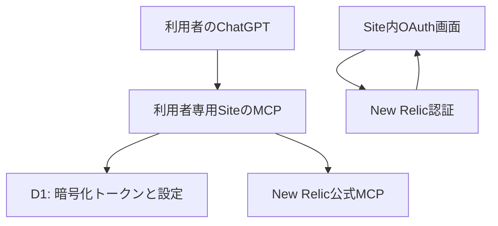

# New Relic × ChatGPT

[](https://github.com/disnana/newrelic-chatgpt-plugin/actions/workflows/ci.yml)
[](https://github.com/disnana/newrelic-chatgpt-plugin/releases/latest)

[English](README.en.md) · [導入手順](docs/setup.md) · [既知の制約](docs/security-review.md)

Disnanaによる**非公式**のNew Relic連携です。各利用者が自分のChatGPT SitesとPluginを作り、New RelicにOAuth接続して監視データを日本語で調査します。所有者限定の個人用セルフホスティングを想定しています。

## できること

- 接続状態とNew Relicアカウントの確認・選択
- 読み取り専用NRQL、メトリクス検索、ログ検索、アラート一覧
- ScyllaDBのメトリクス・属性探索、期間比較
- OAuth PKCE、暗号化保存、同時refresh制御、取得量の制限

New RelicのCore Compute利用量の計測と追加料金は同じ意味ではありません。実際に利用量が契約に含まれるか、別料金になるかはアカウントの料金モデルによりますが、この連携から契約を確認できません。Siteでは通常のCore読み取りを既定で停止し、接続ページの「利用カテゴリごとの許可」から本人が明示的に有効化できます。Advanced Compute (aCCU) のAI分析は別の許可と対応する契約・試用枠が必要です。許可は30日で期限切れになり、いつでも解除できます。読み取り専用は書き込み承認を含みません。メトリクス名やrack属性は実際の取得結果から確認し、推測で固定しません。

## 導入

1. [最新Release](https://github.com/disnana/newrelic-chatgpt-plugin/releases/latest)から `NewRelic-ChatGPT-setup-vX.Y.Z.zip` と `checksums.txt` を取得し、SHA-256を照合する。**初回Release前はこのリンクからZIPを取得できません**。開発者は下記のローカル生成手順を使えます。
2. ChatGPT Sitesが利用可能で、Worker・D1・MCPを作成できる環境を用意する。New Relic側ではMCP機能と組織の読み取り権限が必要です。
3. ZIPをChatGPTへ添付し、[セットアップ文](docs/setup.md)を使って**新しい所有者限定Site**を作る。既存ユーザーのSiteやPluginは使用しません。
4. `DB` binding、6つのD1 migration、MCP capabilityを設定する。Siteごとに独立した暗号鍵を安全に生成して `NEW_RELIC_TOKEN_ENCRYPTION_KEY` Secretに保存する。値をチャット・Git・ログに出力しません。Core、Advanced、Previewの許可は既定ですべて無効です。
5. 所有者限定でSiteを公開すると、Sitesが自分用Pluginを生成します。そのPluginを接続します。このソースZIP自体はPluginインポート用ZIPではありません。
6. Siteでリージョンを選び、New Relic公式OAuthへ接続。localhostに戻ったURL全体を**Site内の認証完了ページ**に貼り付ける。認可URLはチャットに送信しません。
7. Siteで必要なら「公式ツール一覧を取得」を明示的に押し、MCP tools/listをページごとに確認します。次のページや個別スキーマは利用者が選んだときだけ取得します。これはメトリクス・ログ・NRQLを読みませんが、一覧やスキーマの各取得でtools/listを呼び、期限切れ時に通常のOAuth更新を試す場合があります。再接続が必要なら利用者自身が公式OAuthを完了してください。
8. Siteの利用カテゴリごとの許可を確認し、必要な読み取りだけを選択して保存します。Core許可を有効にすると、通常のNRQL・アカウント一覧・メトリクス・ログ・アラートなどを使えます。Advanced許可はaCCU向けAI分析の別設定です。許可だけではNew Relic側の利用権や請求条件を確認できません。アカウントを選択し、読み取り専用クエリを確認します。終了時はSite内の接続解除を使うほか、利用カテゴリの許可を解除できます。New Relic側の認可取消しは別途必要です。

新しい第三者アカウントでの導入一式は未検証です。既存所有者環境での成功を、全ユーザー・全モバイル環境での動作保証と扱わないでください。Sitesの作成権限や表示はプラン・環境に依存します。



## 使用例

```text
New Relicのアカウント一覧を確認して
選択したアカウントで SELECT count(*) FROM Log SINCE 30 minutes ago を実行して
ログのtimeoutを直近30分で検索して
ScyllaDBの実際のメトリクス名を確認してから遅延を調べて
正常時と障害時を同じ指標で比較して。観測と推測を分けて
```

[架空のデータ](examples/sample-data.json)と[クエリ例](examples/queries.nrql)を同梱しています。集計結果や欠測から原因を断定しないでください。

## 開発・テスト・ZIP生成

Node.js 22、Python 3、bashを用意し、展開先で実行します。外部New Relicアカウントや秘密鍵は不要です。

```sh
npm ci
npm run build
npm run validate
npm run typecheck
npm run lint
npm test
npm audit --audit-level=high
python3 scripts/test-migrations.py
python3 scripts/check-distribution.py
python3 scripts/package-release.py v0.4.0
```

`outputs/` にZIPと `checksums.txt` を生成します。タグは `vX.Y.Z` のみを許可します。CIはPR・ブランチpushで検証し、Release workflowはVERSIONを変更したmainへのpush時だけCIを再実行してタグとZIPを公開します。Release作成ジョブのみ `contents: write` を持ちます。VERSIONの更新をmainへマージすると公開Releaseが作成されます。同じバージョンの再利用は拒否されます。

## セキュリティと検証状況

暗号化だけで完全な安全性が保証されるわけではありません。所有者限定で運用し、Siteごとの秘密鍵を使い、認可URLや実ログをIssueへ投稿しないでください。秘密情報検査はパターン検出であり完全ではありません。

- モック検証: state再利用・別ユーザー拒否、Origin、同時refresh・上書き防止、NRQL制限、ページ送り、大容量応答の拒否。
- 未検証: 新規Siteの初回構築、本番D1での並行refresh・リース失効、実ユーザー間の完全な分離、全NRQL構文、全モバイル経路。
- NRQL検証は制限付きで、複雑な構文を拒否します。公式MCP全機能との互換性や全構文の安全性を保証しません。
- 接続解除は保存情報の削除で、New Relic側の失効処理とは異なります。
- New Relic利用量・権限・機能制御と公式OAuthクライアントの利用条件はNew Relicの条件に従います。

詳しくは [OAuth](docs/oauth.md)、[トラブルシューティング](docs/troubleshooting.md)、[セキュリティレビュー](docs/security-review.md)、[構成](docs/architecture.md) を参照。

## ライセンス

独自ソースはMIT。[権利関係](docs/license-notes.md)を参照。New RelicおよびOpenAIの公式製品・承認済み連携ではなく、各社のサービス・商標の権利を付与しません。

## v0.4.0 development status

OAuth failure classification, a fail-closed schema-pinned generic MCP adapter, expiring per-user consent for Core/Advanced/Preview reads, and an opt-in signed-assertion verifier for an external self-host gateway are implemented. A D1-backed approval-session and single-use state-transition foundation now exists, but no reviewed write policy, proposal-creation route, MCP write tool, or provider dispatch is shipped; write/destructive operations remain disabled. The approval flag defaults off. A separate self-host gateway boundary reference is included, but it requires operator-supplied browser/MCP authentication and CSRF adapters and is not a login service or production-ready multi-user gateway. This is **not full official MCP parity**. The documented inventory contains 41 tools, but authenticated live schemas and new runtime execution remain unverified (0 live-verified generic tools). Core and Advanced reads are off until the user selects them in the Site; Core CCU measurement does not by itself prove an additional charge, and the account billing model cannot be verified by the integration. Advanced Compute remains separate and requires the corresponding entitlement or trial. Generic reads require a pinned policy and matching per-user consent. The default identity mode remains ChatGPT Sites; self-host assertion mode and the reference wrapper are locally mocked only and must stay behind an independently reviewed gateway.

See [migration and policy setup](docs/v0.4.0-migration.md), [self-host auth boundary](docs/self-host-auth.md), [gateway reference](examples/self-host-gateway/README.md), [operation approval design](docs/operation-approval-design.md), [official feature research](docs/official-mcp-research.md), [OAuth](docs/oauth.md), and [security review](docs/security-review.md). No production deployment is included.
