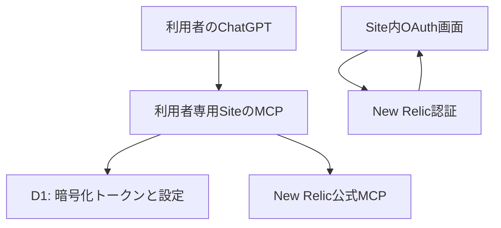

# New Relic × ChatGPT

[](https://github.com/disnana/newrelic-chatgpt-plugin/actions/workflows/ci.yml)
[](https://github.com/disnana/newrelic-chatgpt-plugin/releases/latest)

[English](README.en.md) · [導入手順](docs/setup.md) · [既知の制約](docs/security-review.md)

Disnanaによる**非公式**のNew Relic連携です。各利用者が自分のChatGPT SitesとPluginを作り、New RelicにOAuth接続して監視データを日本語で調査します。所有者限定の個人用セルフホスティングを想定しています。

## コピーしてSitesに渡すセットアップ用プロンプト

ChatGPTでSitesを選び、次のコードブロックをまとめてコピーしてください。GitHubからの取得・Site作成・Secret設定は実行環境の機能と権限に依存します。**このプロンプトでの新規構築一式はまだ未検証です。** 認証画面での操作は利用者本人が行います。

```text
次のOSSを取得し、私専用のChatGPT SiteとPluginをセットアップしてください。
https://github.com/disnana/newrelic-chatgpt-plugin

1. リポジトリのREADME、docs/setup.md、docs/oauth.md、docs/security-review.md、
   VERSION、設定テンプレート、ビルド・テスト手順を確認してください。
   最新の正式ReleaseのZIPとchecksums.txtを取得し、SHA-256を照合して展開してください。
   使用するバージョン・タグ・コミットを記録してください。
   Releaseがまだなければ、その旨を伝えて停止してください。
   GitHubから取得できなければ、Release ZIPの添付を私に案内してください。
   未公開の作業ブランチへ自動で切り替えないでください。

2. ソースを確認し、秘密情報や既存ユーザーのSite IDを引き継がないでください。
   新しい作業ディレクトリから構築し、実アカウントに接続しないモックテストを実行してください。
   検査に失敗した場合は原因を説明し、解決するまでデプロイを止めてください。

3. Sitesの公式手順で新しいWorker ESM Siteを作成し、
   D1 bindingをDB、MCP capabilityを有効にしてください。
   drizzle内のmigrationを順番に適用してください。
   既存のSite・Plugin・認証情報を変更や複製しないでください。

4. このSite専用に暗号学的に安全な32バイトの暗号鍵を生成し、
   base64url形式でNEW_RELIC_TOKEN_ENCRYPTION_KEYというSiteのSecretに保存してください。
   鍵・認可コード・トークンを会話、ログ、Git、配布ファイルに出さないでください。
   安全な生成・Secret設定ができなければ停止し、対応する設定方法を案内してください。

5. ビルドと検証に成功したら、所有者である私だけがアクセスできる設定で公開してください。
   公開範囲を確認し、他の人に共有されていたら停止してください。
   この新しいSiteから生成されるPluginを接続してください。
   Pluginインポート用ZIPを推測で作らないでください。
   課金・購入が必要な操作は実行前に私へ確認してください。

6. SiteのURLを提示し、New Relicのリージョン選択とOAuthログインを案内してください。
   ログインと認可は私自身が行います。
   localhostへの認可URLはSite内の認証完了ページに貼るよう案内し、
   会話へ貼り付けるよう要求しないでください。

7. 認証後は利用可能なアカウントを確認して選択を支援し、
   接続状態と、私が指定した範囲の読み取り専用クエリを確認してください。
   接続解除方法も案内してください。
   実行した確認、未検証事項、Siteの公開範囲、使用バージョンを最後に報告してください。
```

初回Release前の検証で作業ブランチを使う場合は、利用者が対象ブランチまたはコミットを明示して指定してください。

## できること

- 接続状態とNew Relicアカウントの確認・選択
- 読み取り専用NRQL、メトリクス検索、ログ検索、アラート一覧
- ScyllaDBのメトリクス・属性探索、期間比較
- OAuth PKCE、暗号化保存、同時refresh制御、取得量の制限

「New Relicに接続できている？」「直近30分のログを調べて」「rack2とrack3のReactor stallを比較して」のように依頼します。メトリクスとrack属性は取得結果から確認し、推測で名前を固定しません。

## 導入

1. [最新Release](https://github.com/disnana/newrelic-chatgpt-plugin/releases/latest)から `NewRelic-ChatGPT-setup-vX.Y.Z.zip` と `checksums.txt` を取得し、SHA-256を照合する。**初回Release前はこのリンクからZIPを取得できません**。開発者は下記のローカル生成手順を使えます。
2. ChatGPT Sitesが利用可能で、Worker・D1・MCPを作成できる環境を用意する。New Relic側ではMCP機能と組織の読み取り権限が必要です。
3. ZIPをChatGPTへ添付し、[セットアップ文](docs/setup.md)を使って**新しい所有者限定Site**を作る。既存ユーザーのSiteやPluginは使用しません。
4. `DB` binding、2つのD1 migration、MCP capabilityを設定する。Siteごとに独立した暗号鍵を安全に生成して `NEW_RELIC_TOKEN_ENCRYPTION_KEY` Secretに保存する。値をチャット・Git・ログに出力しません。
5. 所有者限定でSiteを公開すると、Sitesが自分用Pluginを生成します。そのPluginを接続します。このソースZIP自体はPluginインポート用ZIPではありません。
6. Siteでリージョンを選び、New Relic公式OAuthへ接続。localhostに戻ったURL全体を**Site内の認証完了ページ**に貼り付ける。認可URLはチャットに送信しません。
7. アカウントを選択し、接続状態と読み取り専用クエリを確認する。終了時はSite内の接続解除を使う。New Relic側の認可取消しは別途必要です。

新しい第三者アカウントでの導入一式は未検証です。既存所有者環境での成功を、全ユーザー・全モバイル環境での動作保証と扱わないでください。Sitesの作成権限や表示はプラン・環境に依存します。



## 使用例

```text
New Relicのアカウント一覧を確認して
選択したアカウントで SELECT count(*) FROM Log SINCE 30 minutes ago を実行して
ログのtimeoutを直近30分で検索して
ScyllaDBの実際のメトリクス名を確認してから遅延を調べて
正常時と障害時を同じ指標で比較して。観測と推測を分けて
```

[架空のデータ](examples/sample-data.json)と[クエリ例](examples/queries.nrql)を同梱しています。集計結果や欠測から原因を断定しないでください。

## 開発・テスト・ZIP生成

Node.js 22、Python 3、bashを用意し、展開先で実行します。外部New Relicアカウントや秘密鍵は不要です。

```sh
npm run build
node scripts/validate-artifact.mjs
node scripts/test-mcp.mjs
python3 scripts/test-migrations.py
python3 scripts/check-distribution.py
python3 scripts/package-release.py v0.3.0
```

`outputs/` にZIPと `checksums.txt` を生成します。タグは `vX.Y.Z` のみを許可します。CIはPR・ブランチpushで検証し、Release workflowはVERSIONを変更したmainへのpush時だけCIを再実行してタグとZIPを公開します。Release作成ジョブのみ `contents: write` を持ちます。VERSIONの更新をmainへマージすると公開Releaseが作成されます。同じバージョンの再利用は拒否されます。

## セキュリティと検証状況

暗号化だけで完全な安全性が保証されるわけではありません。所有者限定で運用し、Siteごとの秘密鍵を使い、認可URLや実ログをIssueへ投稿しないでください。秘密情報検査はパターン検出であり完全ではありません。

- モック検証: state再利用・別ユーザー拒否、Origin、同時refresh・上書き防止、NRQL制限、ページ送り、大容量応答の拒否。
- 未検証: 新規Siteの初回構築、本番D1での並行refresh・リース失効、実ユーザー間の完全な分離、全NRQL構文、全モバイル経路。
- NRQL検証は制限付きで、複雑な構文を拒否します。公式MCP全機能との互換性や全構文の安全性を保証しません。
- 接続解除は保存情報の削除で、New Relic側の失効処理とは異なります。
- New Relic利用量・権限・機能制御と公式OAuthクライアントの利用条件はNew Relicの条件に従います。

詳しくは [OAuth](docs/oauth.md)、[トラブルシューティング](docs/troubleshooting.md)、[セキュリティレビュー](docs/security-review.md)、[構成](docs/architecture.md) を参照。

## ライセンス

独自ソースはMIT。[権利関係](docs/license-notes.md)を参照。New RelicおよびOpenAIの公式製品・承認済み連携ではなく、各社のサービス・商標の権利を付与しません。
